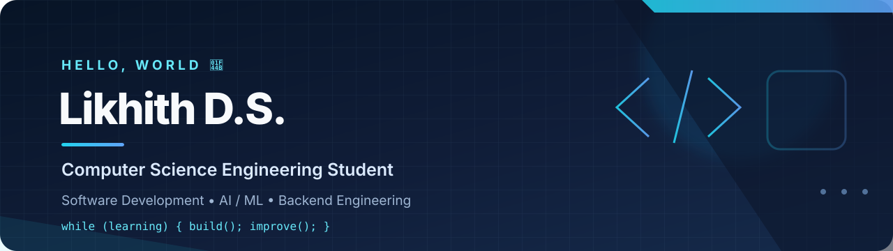

<!-- Profile banner -->

  

  
  
  

  

---

## 👨‍💻 About Me

I'm a **Computer Science and Engineering student at Siddaganga Institute of Technology, Tumakuru**. I enjoy building practical applications, solving programming problems and exploring how AI can improve everyday workflows.

- 💻 Interested in **Software Development, AI/ML and Backend Engineering**
- 🧠 Practising **Data Structures, Algorithms and core CS concepts**
- 🛠️ Building projects with Python, web technologies and databases
- 🌱 Focused on learning by building, testing and improving

## ⚡ Tech Stack

  

## 🚀 Featured Projects

<table>
  <tr>
    <td width="50%" valign="top">
      <h3>🎓 <a href="https://github.com/likhithds1si23cs099-bit/Evista">E-VISTA</a></h3>
      
Educational video insight platform that searches lectures, transcribes audio and supports AI-assisted summaries, translation, quizzes, flashcards and chat.

      
<strong>Stack:</strong> React · FastAPI · Whisper · Gemini · SQLite

    </td>
    <td width="50%" valign="top">
      <h3>🤖 <a href="https://github.com/likhithds1si23cs099-bit/MeetingMind_AI">MeetingMind AI</a></h3>
      
Meeting intelligence application that turns transcripts into summaries, decisions, action items, owners, deadlines and transcript-grounded Q&A.

      
<strong>Stack:</strong> Python · Streamlit · Ollama · Qwen2.5

    </td>
  </tr>
</table>

## 📈 GitHub at a Glance

  
  

  

## 🧩 Coding Practice

  
  
  

## 🤝 Let's Connect

  
  <!-- Add your LinkedIn and public email links here when ready -->

  <b>Build with curiosity. Learn with consistency. Improve every day.</b> 
  Thanks for stopping by ✨

